# System Foundry

An open-source, AI-native backend platform for scalable, resilient, observable systems.

Most engineers watch tutorials. Builders ship systems.

Backend engineers in the AI era must build infrastructure that stays fast, isolates data, and survives outages when autonomous agents run production workloads. System Foundry implements fifteen unified production subsystems in one Go repository.

Each heading below contains a Mermaid diagram. Each diagram shows one architectural path. The prose states the verified parameters and limits of that path.

## System architecture

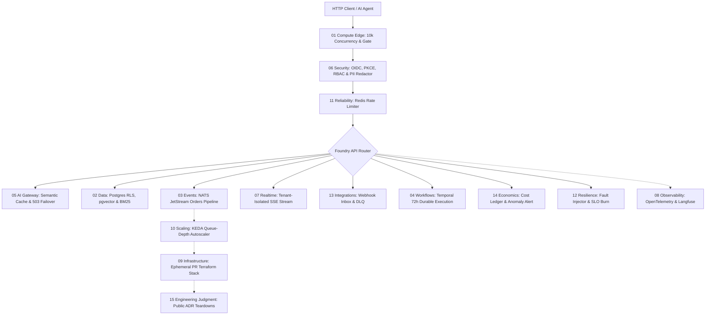

## Words in this file

| Word | Meaning in this file |
| --- | --- |
| tenant | One customer boundary. |
| actor | The subject, the tenant id, and the role on a token. |
| model | Code that returns text for a prompt. |
| event | One order record. Later code does not change that record. |
| span | One named part of one trace. |

## Quick start (local mode)

Local mode needs only Go. It runs search, rate limits, and the cache in memory. It runs NATS JetStream embedded in the process.

```sh
FOUNDRY_MODE=local FOUNDRY_DEMO_PASSWORD=change-me-local go run ./cmd/foundry
```

Demo accounts (all use `FOUNDRY_DEMO_PASSWORD`): `owner@acme.test`, `agent@acme.test` (read-only agent), `owner@beta.test`, `operator@ops.test`. Open `http://127.0.0.1:8080/dashboard` and sign in.

To get a bearer token: `POST /login`, then `GET /authorize` (PKCE S256, client `foundry-cli`, redirect `http://127.0.0.1:8765/callback`), then `POST /token`. `GET /.well-known/openid-configuration` lists the endpoints.

## Full stack (shared mode)

```sh
./scripts/dev-secrets.sh
docker compose up --build
```

Compose starts pgvector Postgres 16, NATS JetStream, Redis 7, a Temporal dev server, the API, the orders worker, and the onboarding worker. The operator is `operator@ops.test`. Its password is in `.local/operator-password`.

## Configuration

| Variable | Mode | Meaning |
| --- | --- | --- |
| `FOUNDRY_MODE` | all | `local` or `shared`. Any other value stops the process. |
| `FOUNDRY_HTTP_ADDR`, `FOUNDRY_ORIGIN` | all | Listen address and OIDC issuer. |
| `FOUNDRY_DEMO_PASSWORD` | local | Seeds demo accounts. Shared mode refuses it. |
| `FOUNDRY_POSTGRES_DSN`, `FOUNDRY_NATS_URL`, `FOUNDRY_REDIS_ADDR` | shared | Required. |
| `FOUNDRY_SIGNING_KEY_FILE` | shared | Required. PEM P-256 key. Every replica signs with this key. |
| `FOUNDRY_BOOTSTRAP_OPERATOR_EMAIL`, `FOUNDRY_BOOTSTRAP_OPERATOR_PASSWORD_FILE` | shared | Creates the first operator. Set both or neither. |
| `FOUNDRY_OAUTH_REDIRECTS` | shared | Comma list of redirect URIs for client `foundry-cli`. |
| `FOUNDRY_TEMPORAL_ADDR` | all | Mounts the onboarding routes. |
| `FOUNDRY_MODEL_BASE_URL`, `FOUNDRY_MODEL_API_KEY`, `FOUNDRY_PRIMARY_MODEL`, `FOUNDRY_CHEAP_MODEL`, `FOUNDRY_EMBED_MODEL` | all | An OpenAI-compatible provider. Without a base URL, a local echo model streams words. |
| `FOUNDRY_PRIMARY_PRICE_MICROS_PER_1K`, `FOUNDRY_CHEAP_PRICE_MICROS_PER_1K` | all | Required with a provider. |
| `FOUNDRY_LANGFUSE_HOST`, `FOUNDRY_LANGFUSE_PUBLIC_KEY`, `FOUNDRY_LANGFUSE_SECRET_KEY` | all | Exports traces to Langfuse. |
| `FOUNDRY_WEBHOOK_SECRET` | all | Mounts `POST /webhooks/{provider}`. |
| `FOUNDRY_CHAOS_ENABLED` | all | `true` mounts `/ops/chaos`. |
| `FOUNDRY_OPS_TENANT` | all | Operator tenant. Default `ops`. |
| `FOUNDRY_RATE_LIMIT_PER_MINUTE` | all | Per-tenant cap. Default 600. |

## Tests

```sh
go test ./... -race
```

Integration tests run when you set these variables (CI sets all of them):

| Variable | Enables |
| --- | --- |
| `FOUNDRY_TEST_POSTGRES_DSN` | RLS, agent role, BM25 parity, credential store, tenant directory |
| `FOUNDRY_TEST_NATS_URL` | Shared mode end to end with a separate orders worker |
| `FOUNDRY_TEST_TEMPORAL=1` | Onboarding start, approve, and provision on a Temporal dev server |
| `FOUNDRY_BENCH_DOCS=N` | Hybrid search latency report over N documents |

## Callers

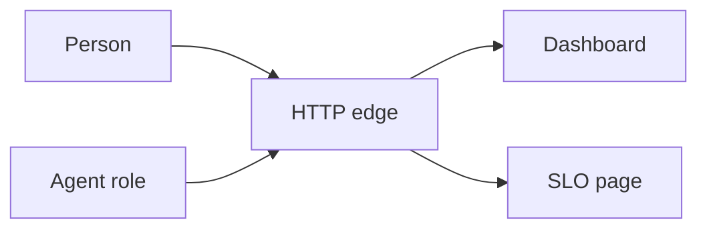

A person and an agent role both call the HTTP edge. The edge serves the dashboard and the SLO page.

## Modes

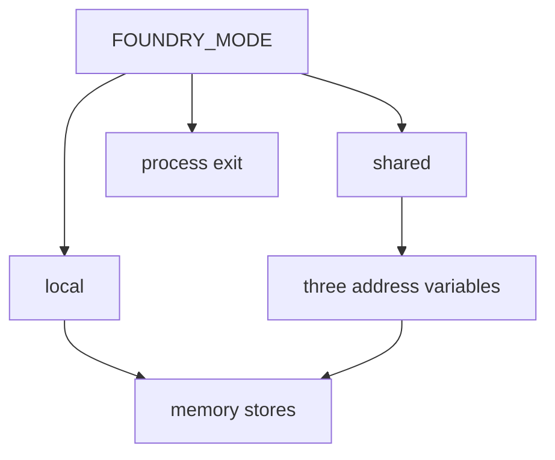

Local mode uses memory stores and embedded JetStream. Shared mode opens Postgres (search and credentials), NATS JetStream, and Redis. Readiness fails when Postgres or NATS is down. Readiness stays green when Redis is down, because the limiter degrades to a local cap.

## Fifteen subsystems

| No. | Subsystem | Why backend engineers build it | Directory |
| --- | --- | --- | --- |
| 01 | High-Concurrency HTTP Server | Handle 10000 concurrent connections with admission control and graceful drain. | [server](server/README.md) |
| 02 | Multi-Tenant Hybrid Search | Isolate tenant data with Postgres RLS, pgvector HNSW, and BM25 ranking. | [search](search/README.md) |
| 03 | Event-Sourced Order Pipeline | Keep the main thread non-blocking: JetStream log, CAS projections, and dead-letter queues. | [events](events/README.md) |
| 04 | Durable Onboarding Workflow | Execute multi-day operations safely with Temporal checkpoints and human approval. | [workflows](workflows/README.md) |
| 05 | AI Gateway with Semantic Cache | Protect uptime and margin with embedding cache, token budgets, and 503 failover. | [gateway](gateway/README.md) |
| 06 | PII-Redacting Auth Middleware | Stop prompt injections from mutating data: OIDC, agent read-only roles, and PII masking. | [auth](auth/README.md) |
| 07 | Real-Time Streaming Dashboard | Stream LLM tokens and database updates with tenant isolation and backpressure. | [streaming](streaming/README.md) |
| 08 | Correlated Tracing Pipeline | Link each HTTP request to the exact prompt and database query in OpenTelemetry and Langfuse. | [observability](observability/README.md) |
| 09 | Ephemeral PR Provisioner | Prevent configuration drift: deploy an isolated Docker environment for every pull request. | [infrastructure](infrastructure/README.md) |
| 10 | Queue-Based Autoscaler | Cut cloud bills: scale workers on queue lag and down to zero with spot fallback. | [autoscaling](autoscaling/README.md) |
| 11 | Distributed Rate Limiter | Prevent cascading outages: Redis token bucket that degrades to local limits on partitions. | [rate-limiting](rate-limiting/README.md) |
| 12 | Chaos Engineering Suite | Prove resilience under failure with latency, replica kills, partitions, and SLO burn alerts. | [chaos](chaos/README.md) |
| 13 | Webhook Reconciliation Engine | Make integrations dependable with idempotent retries, exponential backoff, and DLQ replay. | [reconciliation](reconciliation/README.md) |
| 14 | Cost-per-Request FinOps | Attribute spend with per-tenant, per-model cost rollups and 3x anomaly alerts. | [finops](finops/README.md) |
| 15 | Public Architecture Teardowns | Prove engineering judgment through system diagrams, ADRs, and measured benchmarks. | [architecture](architecture/README.md) |

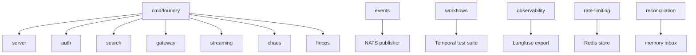

`cmd/foundry` wires all fourteen code packages. `cmd/orders-worker` consumes JetStream. KEDA scales it. `cmd/onboarding-worker` runs the Temporal workflow.

## HTTP edge

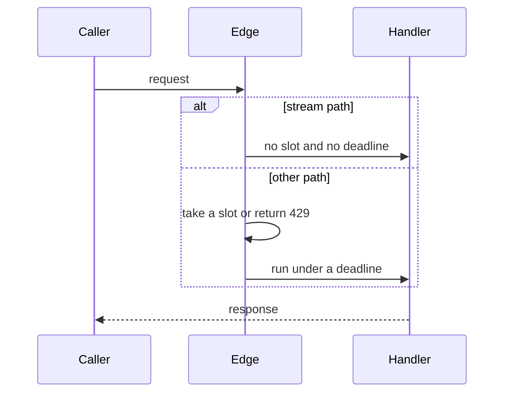

The process allows 10000 in-flight requests. The wait queue holds 1024 requests.

A full wait queue returns HTTP 429 and `Retry-After: 1`. The error code is `TOO_MANY_REQUESTS`.

A normal request deadline is 15 seconds. `POST /v1/complete` has a deadline of 17 seconds.

`GET /stream` does not take an in-flight slot. `GET /stream` has no request deadline.

`GET /livez` does not call other stores. `GET /readyz` calls the ready function.

A stop signal cancels open streams. The edge then waits up to 15 seconds for other requests.

The edge sets `X-Request-ID` on each response.

Gate enter and leave measured 28.74 ns/op, with 0 B/op and 0 allocs/op, on an AMD Ryzen 5 6600H.

## Routes

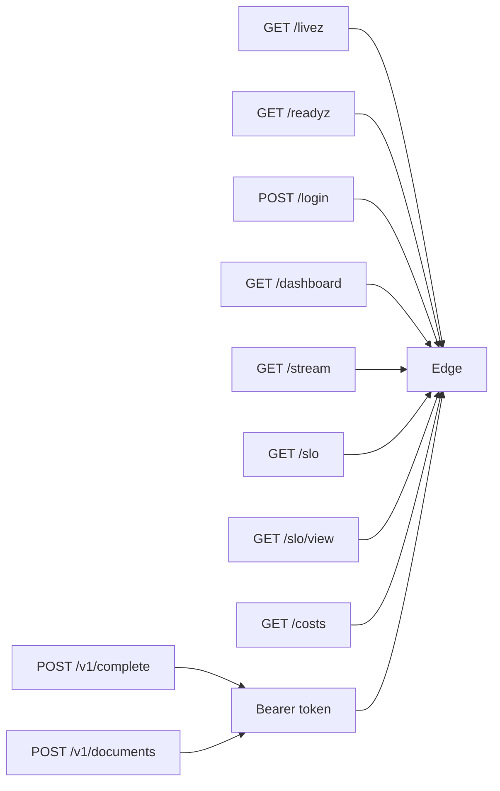

| Method and path | Who can call | What the process does |
| --- | --- | --- |
| `GET /livez`, `GET /readyz` | Any caller | Liveness, and readiness of Postgres and NATS. |
| `GET /.well-known/openid-configuration`, `GET /jwks.json` | Any caller | OIDC discovery and the ES256 public key. |
| `POST /login`, `POST /logout` | Same origin | Session cookie. |
| `GET /authorize`, `POST /token` | Session, then client | Authorization code with PKCE S256, and refresh rotation. |
| `GET /dashboard` | Any caller | Dashboard HTML. |
| `GET /stream` | Session cookie | Server-sent events for the caller's tenant only. |
| `GET /slo`, `GET /slo/view` | Any caller | 5-minute and 1-hour burn rates from real responses. |
| `POST /v1/complete` | Bearer | JSON `{"prompt","maxTokens"}`. Streams tokens to the tenant's dashboard. |
| `POST /v1/documents` | Bearer, write role | JSON `{"id","title","body"}`. |
| `GET /v1/search?q=` | Bearer | Hybrid BM25 + vector search with RRF. |
| `POST /v1/orders/{order}/events` | Bearer, write role, `Idempotency-Key` | Appends one immutable event. |
| `GET /v1/orders/{order}` | Bearer | Projected order view. |
| `GET /v1/costs` | Bearer | 24-hour cost rollup and alert for the caller's tenant. |
| `POST /webhooks/{provider}` | HMAC signature | Stores the event, answers 202, and applies it later. |
| `POST /ops/users` | Operator | Creates a user. |
| `GET /ops/webhooks/dead`, `POST /ops/webhooks/{provider}/{id}/replay` | Operator | Dead-letter list and replay. |
| `POST /ops/onboarding`, `POST /ops/onboarding/{tenant}/approve` | Operator | Starts the workflow, and sends the human approval. |
| `GET/PUT/DELETE /ops/chaos` | Operator | Fault injection rule. |

Every bearer route passes the per-tenant rate limit. An operator is an owner in `FOUNDRY_OPS_TENANT`.

A success body is `{"ok":true,"data":...}`. A failure body is `{"ok":false,"error":{"code","message","fieldErrors"}}`.

Failure codes are `UNAUTHENTICATED`, `FORBIDDEN`, `NOT_FOUND`, `VALIDATION_FAILED`, `CONFLICT`, `UNAVAILABLE`, and `TOO_MANY_REQUESTS`.

## Login and access

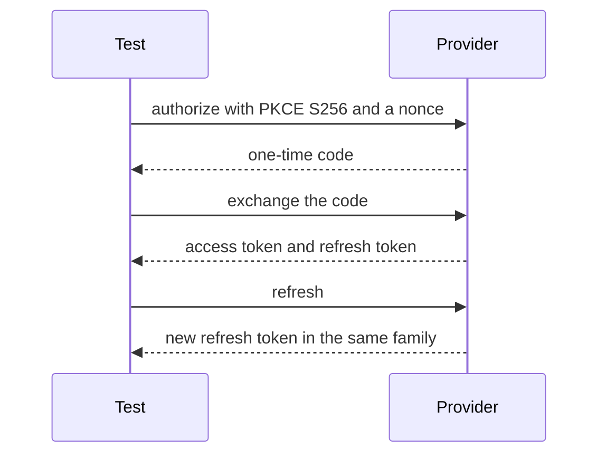

The process mounts the full code flow. Shared mode stores users, hashed sessions, hashed codes, and refresh tokens in Postgres under role `auth_service`.

The PKCE method is `S256`. Authorize requires a nonce. The signer is ES256.

An access token lasts 10 minutes. A refresh token lasts 24 hours.

A second use of one refresh token revokes that token family.

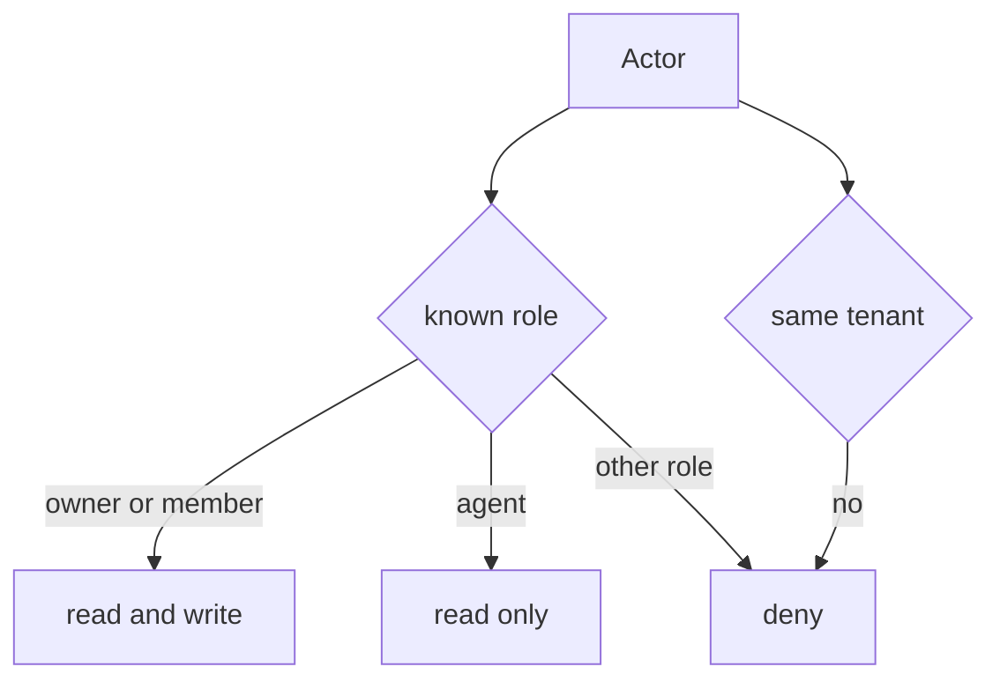

`auth.Can` permits read and write for `owner` and `member`. It permits read for `agent`.

`auth.Can` denies write for `agent`. It denies an unknown role.

`auth.Can` denies an empty subject, an empty tenant, and a tenant that is not the actor tenant.

HTTP tests return 404 when the URL tenant is not the actor tenant. Those routes exist on the test server.

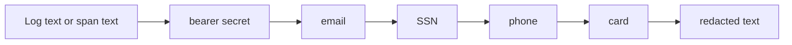

The redactor replaces a bearer secret, an email, an SSN, a phone, and a card, in that order.

## Search

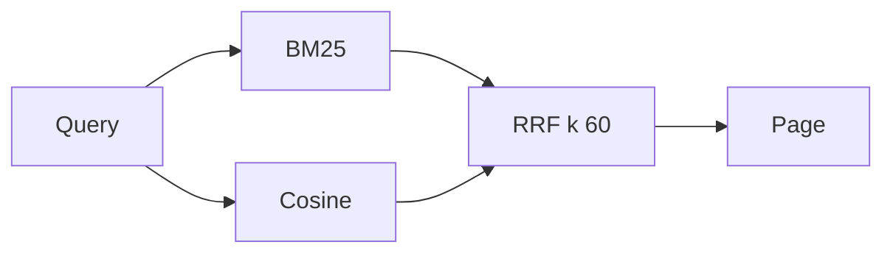

BM25 uses k1 `1.2` and b `0.75`. The vector has 256 dimensions. The gateway cache uses that same hash.

A page limit above 50 becomes 50. The memory store keeps at most 10000 documents for one tenant.

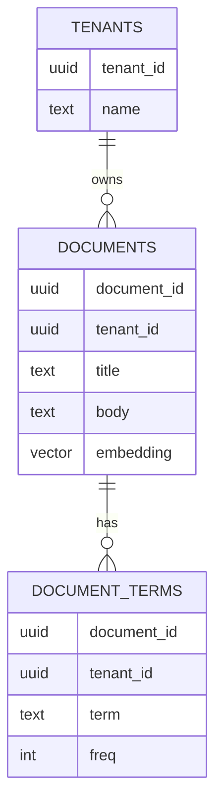

The SQL file enables row-level security on `documents` and `document_terms`. The policy reads `app.tenant_id`.

The app logs in as `foundry_app NOINHERIT`. That role has no table access of its own. Each transaction runs `SET LOCAL ROLE app_writer` (owner, member) or `agent_reader` (agent), then `set_config('app.tenant_id', $1, true)`. A missed step fails closed.

Shared mode runs BM25 inside Postgres over `document_terms`. Tests on Postgres 16 with pgvector 0.6.2 prove three behaviors. The same document id in two tenants stays apart. The agent role gets `42501` on write. SQL BM25 order matches the in-memory ranker.

Known limit: the HNSW index is global. RLS filters rows after the index scan. A small tenant can receive fewer than `ef_search` semantic hits. Upgrades to pgvector 0.8 iterative scans resolve this recall gap.

## Order events

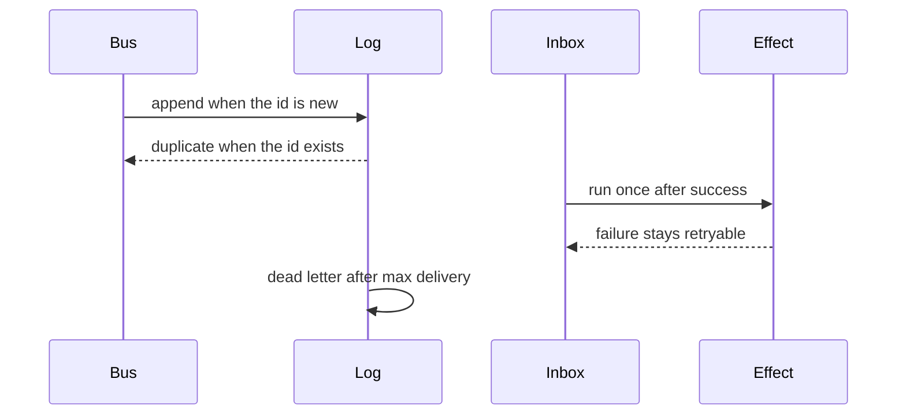

Event kinds are `order.placed`, `order.paid`, and `order.cancelled`.

The subject is `orders.<tenant>.<kind>`. A payload larger than 8192 bytes is invalid.

Stream `ORDERS` denies delete and purge. JetStream dedupes a repeated `Nats-Msg-Id` for 2 minutes. The worker folds events into KV bucket `order-views` with compare-and-swap. The fold is order-independent and skips an event id it already applied. So a redelivery cannot change state. The worker routes poison messages or messages with 5 failed deliveries to `ORDERS_DLQ`, then acknowledges the stream.

## Onboarding

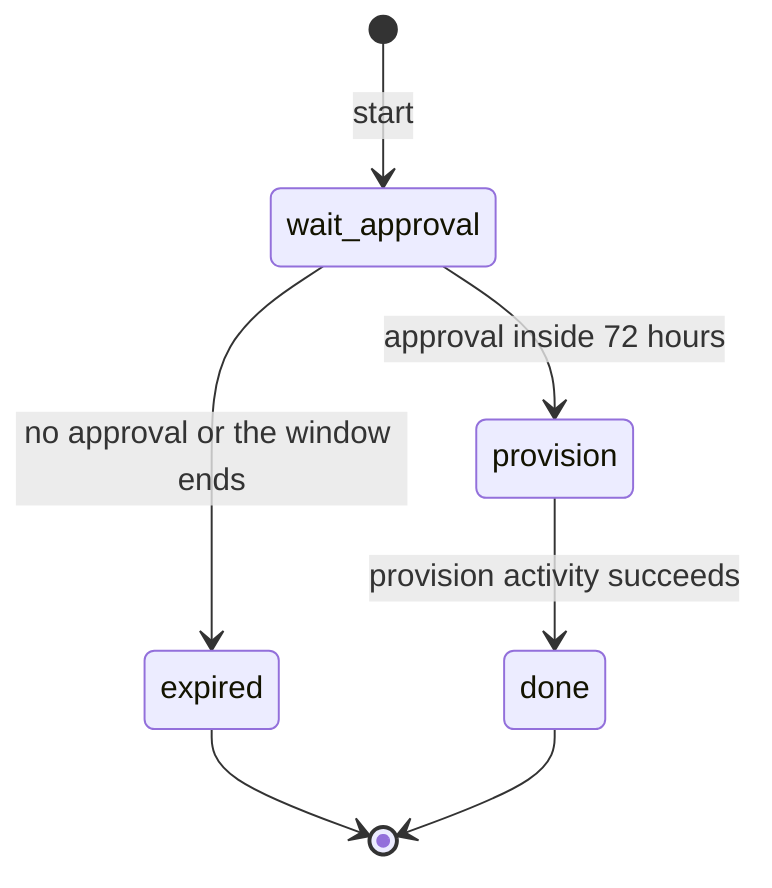

The approval window is 72 hours. The signal name is `approve`.

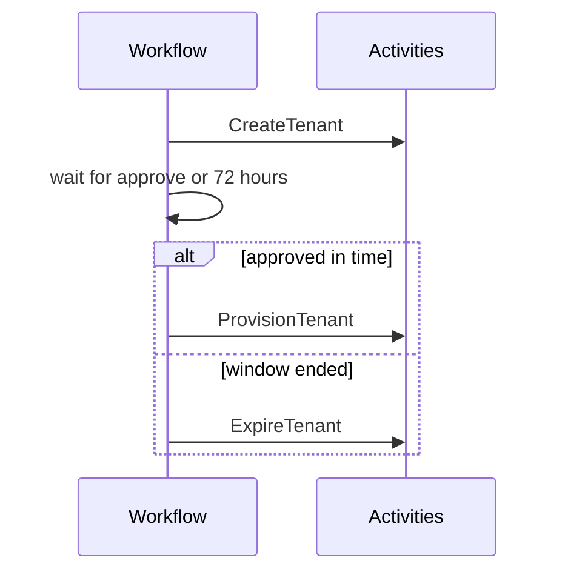

Activity retry starts at 1 second, doubles, and stops after 5 attempts.

The workflow version marker is `onboard-v1`. The activities move `tenants.status` through `pending`, `active`, and `expired`. A test runs start, duplicate start (409), approve, and provision on a real Temporal dev server.

## Model proxy

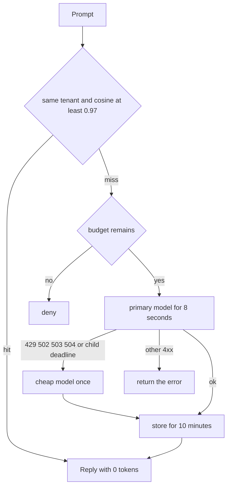

The cache holds at most 10000 entries. The default budget is 100000 tokens for one tenant.

With `FOUNDRY_MODEL_BASE_URL`, the proxy calls an OpenAI-compatible API, streams tokens, and caches by provider embeddings (cosine 0.95). Failover happens only before the first token. Without a base URL, a local echo model streams words.

The token budget does not reset. It lasts for the process lifetime.

Primary price is 30000 micro-USD for 1000 tokens. Cheap price is 1000 micro-USD for 1000 tokens.

An unknown model name uses the primary price. A cache hit records 0 tokens.

The budget and the cache live in the process. A restart clears both.

A cache hit measured 887.9 ns/op, 1120 B/op, and 2 allocs/op.

## Live pages

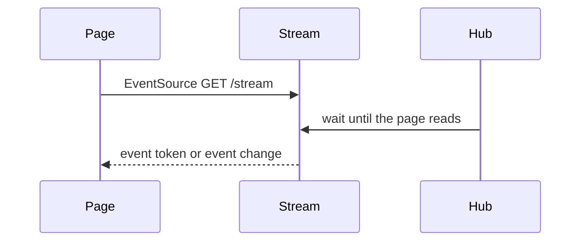

Each subscriber gets only messages for its tenant. Each buffer holds 64 messages. The hub drops a subscriber that fails to read within 250 ms. This drop prevents slow clients from stalling publishers.

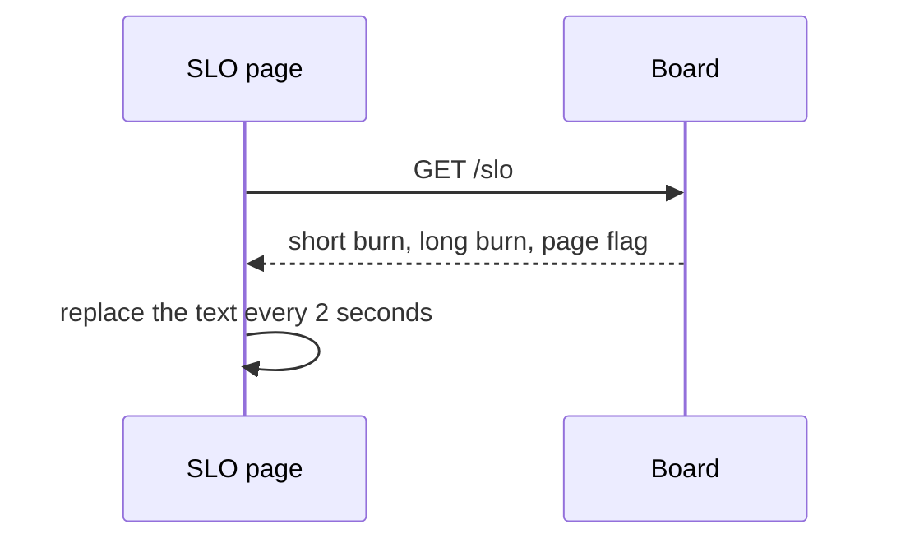

The SLO page reads `/slo` every 2 seconds. It does not reload the document.

## Traces

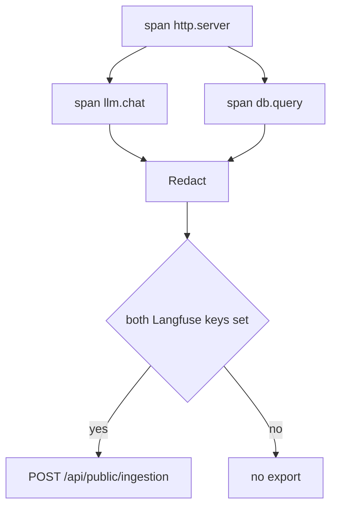

The three span names share one trace. The middleware continues an incoming `traceparent` and returns `X-Trace-ID`. Prompt text and SQL text pass through the redactor. Every process log line passes through the same redactor.

## Request cap

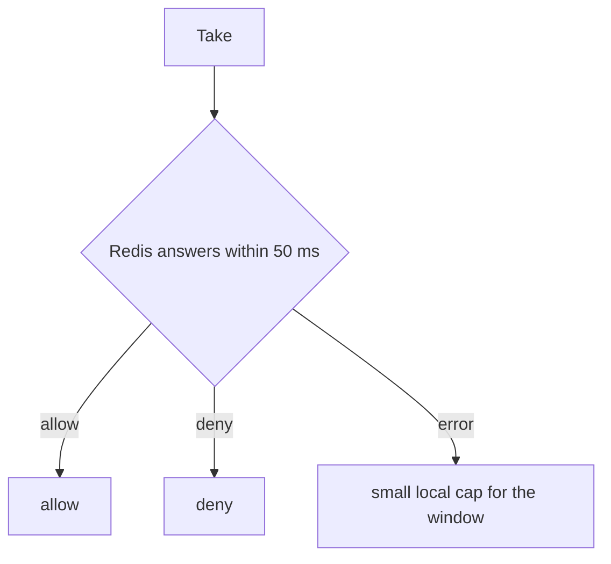

The Redis key is `ratelimit:tenant:<id>:v1`. The tenant id matches `^[A-Za-z0-9_-]{1,64}$`.

A store error uses the local cap (one tenth of the limit) and sets `X-RateLimit-Degraded: 1`. The limiter does not allow every request.

## Faults and SLO

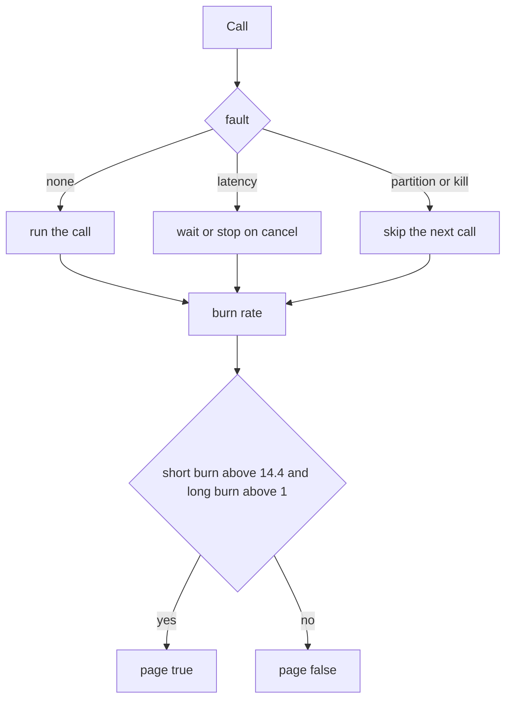

The SLO objective is `0.999`. Every 5xx response counts against it. For real replica kills and partitions in Kubernetes, `chaos/experiments/` holds Chaos Mesh manifests.

## Webhook inbox

```mermaid
stateDiagram-v2
  [*] --> pending: Accept stores the event
  pending --> applied: Drain succeeds
  pending --> pending: Drain fails and attempts remain
  pending --> dead: attempts reach 8
  dead --> pending: replay
  applied --> [*]
```

The signature is HMAC-SHA256 hex. The inbox key is the provider plus the event id.

Delay starts at 100 ms, doubles each attempt, and stops at 30 seconds, plus jitter.

Replay starts only from `dead`. `Accept` stores the event. `Drain` runs the effect.

An applied webhook payload is an order event. It goes into the order pipeline. The inbox is in memory, so a restart drops pending webhooks.

## Cost ledger

```mermaid
flowchart LR
  call[Complete call] --> row[append micro-USD row]
  row --> roll[24 hour rollup]
  roll --> alert{this hour above 3 times the earlier mean}
  alert -->|yes| flag[alert]
  alert -->|no| quiet[no alert]
```

The ledger keeps rows for 35 days. Money is an `int64` count of micro-USD.

The ledger stores hourly buckets, so a write is O(1). `GET /v1/costs` returns the caller's rollup. A spike above 3 times the 24-hour mean logs `cost_anomaly` once per tenant-hour, and the dashboard shows it. The ledger lives in the process.

## Pull-request stack

```mermaid
flowchart LR
  pr[pr_number] --> net[Docker network]
  net --> pg[pgvector Postgres 16]
  net --> nats[NATS 2.10 with JetStream]
  net --> redis[Redis 7]
  net --> app[app image]
```

The Postgres password is a sensitive variable. It has no default.

`.github/workflows/preview.yml` applies the stack for each pull request on a self-hosted runner labeled `foundry-preview`. State lives in `/var/lib/foundry-previews/pr-N.tfstate`. The app listens on port `20000 + N`. Closing the pull request destroys the stack. `terraform validate` passes. No apply has run yet.

## Replica count

```mermaid
flowchart TD
  api[foundry-api] --> one[1 replica]
  lag[JetStream lag] --> keda[KEDA]
  keda --> worker[foundry-orders]
  worker --> range[0 to 10 replicas]
  keda --> fallback[1 replica when the scaler fails]
  spot[spot weight 50] --> worker
  demand[on-demand weight 10] --> worker
```

The lag threshold is 10. The orders container runs `/orders-worker` and prefers spot nodes. The manifests pass kubeconform. They were not applied to a cluster.

## Measures

Host: AMD Ryzen 5 6600H, linux/amd64.

| Check | Result |
| --- | --- |
| Gate enter and leave | 28.74 ns/op, 0 B/op, 0 allocs/op |
| BM25, 1000 documents | 337350 ns/op, 25272 B/op, 11 allocs/op |
| Cache hit | 887.9 ns/op, 1120 B/op, 2 allocs/op |

| Postgres hybrid search, 100000 documents, 30-word vocabulary | p50 523 ms, p99 668 ms |

The 100000-document row uses a deliberately bad corpus: every query term matches almost every document. It misses a 100 ms target. A run with a Zipf corpus at 10000 documents did not finish. See the hybrid search teardown.

## Read next

The three teardowns are [the HTTP edge](architecture/compute-edge.md), [hybrid search](architecture/hybrid-search.md), and [the model proxy](architecture/ai-gateway.md).

Each directory README states the job for that directory.
