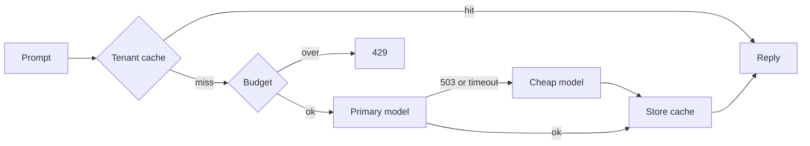

# AI gateway

Subsystem: `gateway`.

The proxy embeds the prompt, looks up a tenant-scoped cache, and reserves a token budget. A cache hit does not call a model. A 503, 502, 504, 429, or timeout on the primary model calls the cheap model once. A 400 does not fail over. Cache entries expire after 10 minutes. The cache holds at most 10,000 entries.

Cost uses a configured price table, not a cloud invoice. Primary is 30,000 micro-USD per 1,000 tokens. Cheap is 1,000 micro-USD per 1,000 tokens. A cache hit records 0 tokens.

## Measurement

Host: AMD Ryzen 5 6600H, linux/amd64, Go.

`BenchmarkCacheHit-12` after one warm call:

- 887.9 ns/op
- 1120 B/op
- 2 allocs/op

The failover, budget, and tenant-isolation checks are in `gateway/proxy_test.go`. They use scripted models. They do not call a hosted LLM.

The HTTP edge gives `POST /v1/complete` a 17 second deadline. Each model call receives 8 seconds, so a timeout on the primary still leaves time for one cheap call.

## ADR

Decision: keep the semantic cache in the process, keyed by tenant, and fail over once on a temporary model error.

Requirement: protect spend and uptime when the expensive model returns 503.

Alternative: a shared Redis cache. That adds a store before a measured miss-cost requires it.

Revisit when cache misses dominate the model bill.
