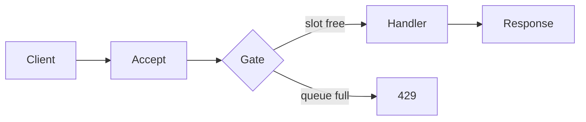

# Compute edge

Subsystem: `server`.

The edge accepts HTTP on one process. A gate caps in-flight requests and waiting requests. A full gate returns 429 and `Retry-After: 1`. A long-lived stream does not take an in-flight slot. `SIGTERM` stops new accepts and drains in-flight work. `/livez` does not call dependencies. `/readyz` does. The API deployment stays at one replica. The orders worker is the deployment KEDA scales.

## Measurement

Host: AMD Ryzen 5 6600H, linux/amd64, Go.

`BenchmarkGateEnterLeave-12` on 2026-10-02:

- 28.74 ns/op
- 0 B/op
- 0 allocs/op

`TestTenThousandConcurrentConnections` held 10,000 in-flight HTTP requests. The single-test run finished in 2.443s. That time includes dial, hold, and release. It is not a latency percentile.

## ADR

Decision: cap in-flight work with a buffered channel and a separate wait channel.

Requirement: 10,000 concurrent connections, graceful shutdown, and backpressure.

Alternative: one unbounded goroutine per request with no shed point. That hides overload until memory fails.

Revisit when sustained connections exceed 20,000.
