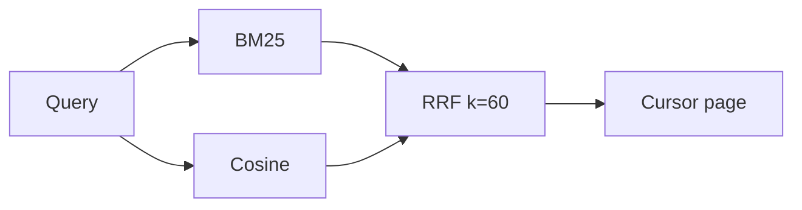

# Hybrid search

Subsystem: `search`.

The engine scores a tenant document two ways. BM25 scores keyword overlap. Cosine scores a 256-dimension hash embedding. Reciprocal rank fusion with k=60 merges the two lists. The actor tenant comes from the caller. The query does not choose the tenant.

Postgres row-level security is in `search/sql/20261002_documents.sql`. The policy reads `app.tenant_id`. The role `agent_reader` has `SELECT` only.

## Measurement

Host: AMD Ryzen 5 6600H, linux/amd64, Go.

`BenchmarkBM25ThousandDocs-12` scored 1,000 documents:

- 337350 ns/op
- 25272 B/op
- 11 allocs/op

That is about 0.337 ms for one BM25 pass over 1,000 documents in this process. The same pass over 1,000,000 documents is about 337 ms if the cost stays linear in document count. That misses a 100 ms target. It is not a Postgres `EXPLAIN`.

Tenant scope for a pooled connection is `SELECT set_config('app.tenant_id', $1, true)`. The third argument makes the setting local to the transaction.

## ADR

Decision: in shared mode, run BM25 in SQL over `document_terms` and vectors through pgvector, in one transaction under RLS. Fuse the two lists in Go with RRF. The app role is `NOINHERIT`, so every transaction must choose `app_writer` or `agent_reader`.

Requirement: one query path for keywords and vectors, with tenants isolated.

Alternative: `tsvector` rank in place of BM25. That is not BM25.

Tests on Postgres 16 with pgvector 0.6.2 verify the design. The migration applies twice on one cluster. The same document id stays separate across tenants. The `agent_reader` role gets `42501` on write. A transaction with no tenant set sees 0 rows. SQL BM25 order matches the Go ranker.

Measurements on Postgres 16 used 100,000 documents in one tenant, a 30-word vocabulary, and 200 queries. Latency was p50 523 ms, p95 582 ms, and p99 668 ms. This corpus is the worst case: every term matches almost every document. It misses 100 ms. A Zipf-corpus run at 10,000 documents failed before it reported. That run is open work.

Next steps: top-k pruning in the BM25 path (pg_search, or WAND over a term-score table), and pgvector 0.8 iterative scans for the post-filter recall gap.

Revisit when one tenant exceeds 100,000 documents.
